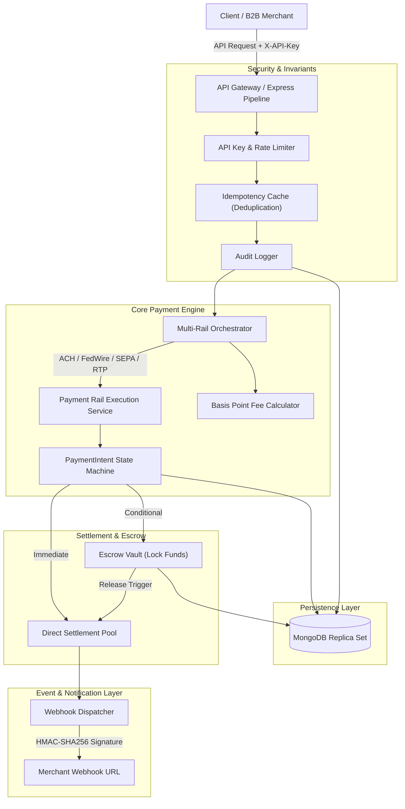

# 💳 NexusPay — Enterprise B2B Multi-Rail Payment Gateway, Escrow & Webhook Reconciliation Engine

[](https://nodejs.org)
[](https://expressjs.com)
[](https://mongodb.com)
[](https://reactjs.org)
[](https://docker.com)
[](https://opensource.org/licenses/MIT)

**NexusPay** is a production-grade enterprise B2B payment orchestration platform engineered to unify fragmented domestic and cross-border settlement rails into a single, high-reliability API. NexusPay incorporates an autonomous routing engine (ACH, FedWire, SEPA Credit, RTP, and Credit Cards), dual-phase escrow fund holding, cryptographically signed webhook dispatches, and an audit-logged double-entry reconciliation engine.

---

## 🏛️ System Architecture



---

## ✨ Key Enterprise Capabilities

1. **Multi-Rail Smart Routing Engine**
   - Automatically routes transactions through ACH, FedWire, SEPA, Card, or Real-Time Payments (RTP) based on amount, currency, speed tier, and merchant preference.
   - Built-in cutoff time awareness and automatic fallback to secondary rails upon upstream settlement degradation.

2. **Dual-Phase Escrow & Dispute Governance**
   - Programmable fund hold mechanisms with configurable inspection periods and multi-party milestone approvals.
   - Automated dispute freezing and one-click arbitrated fund release or full refund.

3. **Strict Financial Idempotency**
   - `Idempotency-Key` header enforcement prevents double-debiting under flaky network conditions.
   - Atomic lock reservation ensures concurrent requests for the same intent result in identical, cached idempotency responses.

4. **Cryptographic Webhook Dispatcher**
   - Every state change triggers a signed webhook payload using HMAC-SHA256 with timestamp verification.
   - Exponential retry backoff algorithm (1s, 5s, 25s) with exhaustive HTTP delivery attempt logs.

5. **Tamper-Evident Financial Audit Trail**
   - Immutable audit logging captures every state mutation, actor ID, client IP, previous state, and new state.

---

## 🔌 RESTful API Reference

### 1. Payment Intents
- `POST /api/payments/intent` — Create a new payment intent with selected rail, amount, and currency.
- `POST /api/payments/confirm/:id` — Authorize and capture funds through the selected payment rail.
- `POST /api/payments/cancel/:id` — Cancel an uncaptured intent and release reserved limits.
- `GET /api/payments/:id` — Retrieve real-time status and settlement details for an intent.

### 2. Escrow Management
- `POST /api/escrow/create` — Place settled transaction funds into escrow hold.
- `POST /api/escrow/release/:id` — Authorize release of funds to merchant balance.
- `POST /api/escrow/dispute/:id` — Freeze escrow hold pending arbitration review.
- `POST /api/escrow/refund/:id` — Refund escrow balance back to customer.

### 3. Webhooks & Subscriptions
- `GET /api/webhooks/subscriptions` — List active webhook endpoints and secrets.
- `POST /api/webhooks/test-ping` — Dispatch a signed mock event to test merchant endpoint integration.
- `GET /api/webhooks/deliveries` — Review historical webhook delivery logs with status codes.

### 4. Merchant & Analytics
- `GET /api/merchants/me` — Inspect merchant tier, balances, and operational limits.
- `GET /api/analytics/summary` — Aggregate transaction volume, rail breakdown, and collected fee metrics.

---

## 🧪 Automated Test Suite

NexusPay features complete, native Node.js automated test suites covering financial invariants:

```bash
# Run all test suites
npm test

# Run tests with code coverage analysis
npm run test:coverage
```

### Test Coverage Breakdown
- `server/tests/paymentOrchestrator.test.js` — State machine transition validity and fee calculation formulas.
- `server/tests/escrowManager.test.js` — Fund lock, release, dispute, and refund invariant validations.
- `server/tests/idempotency.test.js` — Replay attack prevention and atomic lock expiration.
- `server/tests/webhookSignature.test.js` — HMAC-SHA256 payload signing and tamper detection.
- `server/tests/feeCalculator.test.js` — Basis point math, fixed surcharges, and volume tier discounts.
- `server/tests/e2ePaymentLifecycle.test.js` — End-to-end intent creation $	o$ capture $	o$ escrow hold $	o$ settlement $	o$ signed webhook delivery.

---

## 🚀 Quickstart & Installation

```bash
# 1. Clone repository
git clone https://github.com/developertdsl-prog/nexuspay.git
cd nexuspay

# 2. Install dependencies
npm install
cd client && npm install && cd ..

# 3. Configure environment variables
cp .env.example .env

# 4. Seed initial merchant fixtures and mock payments
npm run seed

# 5. Start development backend
npm run dev
```

---

## 🐳 Docker Deployment

```bash
# Build and launch with Docker Compose
docker-compose up --build -d

# Check cluster logs
docker-compose logs -f
```

---

## 📄 License
Licensed under the [MIT License](LICENSE). Designed & Maintained by `developertdsl-prog` (<developer.tdsl@gmail.com>).
